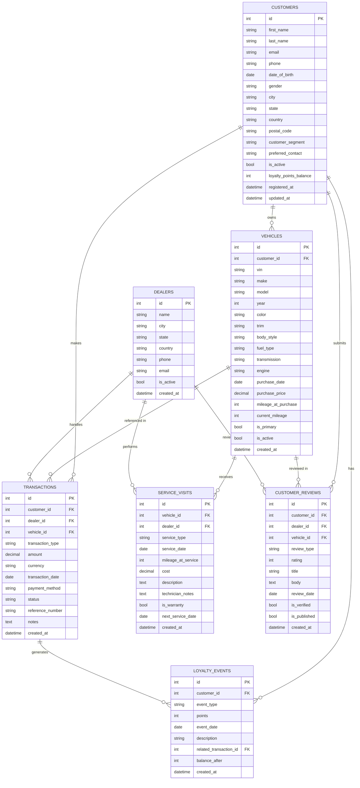

# AutoInsight360 — Entity Relationship Diagram

> **Phase 1 — Database Foundation**
> This ERD reflects the implemented SQLAlchemy ORM models in `backend/app/database/models.py`.

---

## Entity Relationship Diagram

---

## Table Descriptions

### DEALERS
Represents automotive dealerships. Each dealer can handle multiple transactions and service visits. Dealers are the fixed reference entities in the system (5 dealers in the demo dataset).

### CUSTOMERS
Individual automotive customer profiles. The central entity in the Customer 360 model. Maintains a denormalised `loyalty_points_balance` for fast lookup.

### VEHICLES
Customer-owned vehicles. Each vehicle is associated with one customer (owner). The `is_primary` flag marks the customer's main vehicle. VINs are prefixed with `SYNTH-` in the demo dataset.

### TRANSACTIONS
Financial transactions between a customer and a dealer. May optionally reference a specific vehicle (e.g. for purchase or service payment transactions). Transaction types: `vehicle_purchase`, `service_payment`, `parts`, `accessories`, `financing`.

### SERVICE_VISITS
Records of vehicle maintenance and repair visits at a dealer. Each visit is linked to a specific vehicle and dealer. Includes mileage, cost, service type, and technician notes.

### LOYALTY_EVENTS
Audit log of loyalty points earned, redeemed, or adjusted for a customer. The `balance_after` field captures the running balance at the time of each event. Event types: `earn`, `redeem`, `bonus`, `adjustment`, `expiry`.

### CUSTOMER_REVIEWS
Customer-submitted ratings and reviews. Can be associated with a dealer, a vehicle, or a service experience. Rating is 1–5 stars. Review types: `dealer`, `vehicle`, `service`.

---

## Key Relationships

| Relationship | Type | Description |
|---|---|---|
| Customer → Vehicle | 1 to many | A customer may own one or more vehicles |
| Customer → Transaction | 1 to many | A customer may have many transactions |
| Customer → LoyaltyEvent | 1 to many | A customer has a full loyalty history |
| Customer → CustomerReview | 1 to many | A customer may submit multiple reviews |
| Vehicle → ServiceVisit | 1 to many | A vehicle accumulates service history over time |
| Vehicle → Transaction | 1 to many | A vehicle may appear on multiple transactions |
| Dealer → Transaction | 1 to many | A dealer handles many customer transactions |
| Dealer → ServiceVisit | 1 to many | A dealer performs many service visits |
| Transaction → LoyaltyEvent | 1 to many | A transaction may generate loyalty events |

---

## Indexes

| Table | Index | Purpose |
|---|---|---|
| customers | `ix_customers_email` | Unique email lookups |
| customers | `ix_customers_last_name` | Name-based search |
| vehicles | `ix_vehicles_customer_id` | Customer vehicle lookups |
| vehicles | `ix_vehicles_vin` | VIN-based lookups |
| transactions | `ix_transactions_customer_id` | Customer transaction history |
| transactions | `ix_transactions_dealer_id` | Dealer transaction reporting |
| transactions | `ix_transactions_date` | Date-range queries |
| service_visits | `ix_service_visits_vehicle_id` | Vehicle service history |
| service_visits | `ix_service_visits_dealer_id` | Dealer service reporting |
| service_visits | `ix_service_visits_date` | Date-range queries |
| loyalty_events | `ix_loyalty_events_customer_id` | Customer loyalty history |
| loyalty_events | `ix_loyalty_events_date` | Date-range queries |
| customer_reviews | `ix_customer_reviews_customer_id` | Customer review lookups |
| customer_reviews | `ix_customer_reviews_dealer_id` | Dealer review lookups |

---

## Database Constraints

| Table | Constraint | Rule |
|---|---|---|
| customers | UNIQUE | `email` must be unique |
| vehicles | UNIQUE | `vin` must be unique |
| vehicles | CHECK | `year >= 1900 AND year <= 2100` |
| transactions | UNIQUE | `reference_number` must be unique |
| transactions | CHECK | `amount >= 0` |
| service_visits | CHECK | `cost >= 0` |
| customer_reviews | CHECK | `rating >= 1 AND rating <= 5` |
| dealers | UNIQUE | `name` must be unique |

---

*ERD generated for Phase 1 — Database Foundation. Last updated: 2026-11-21.*
